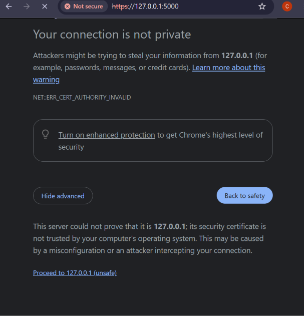
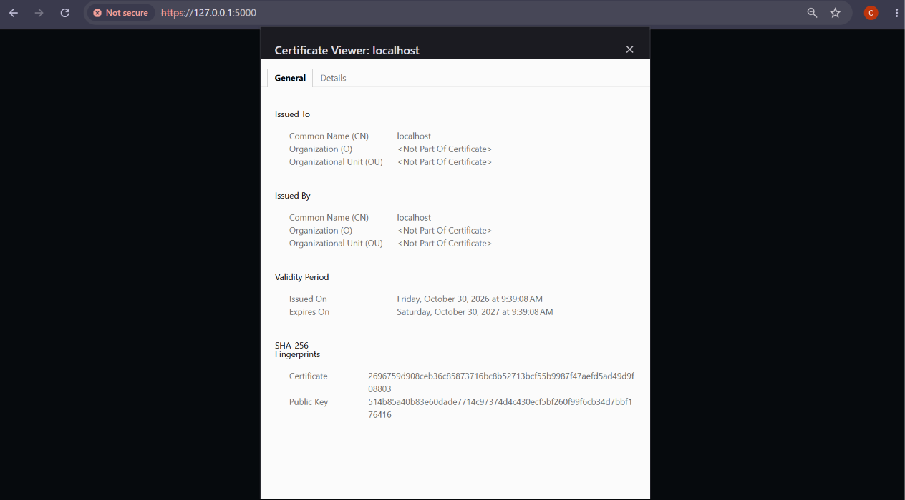
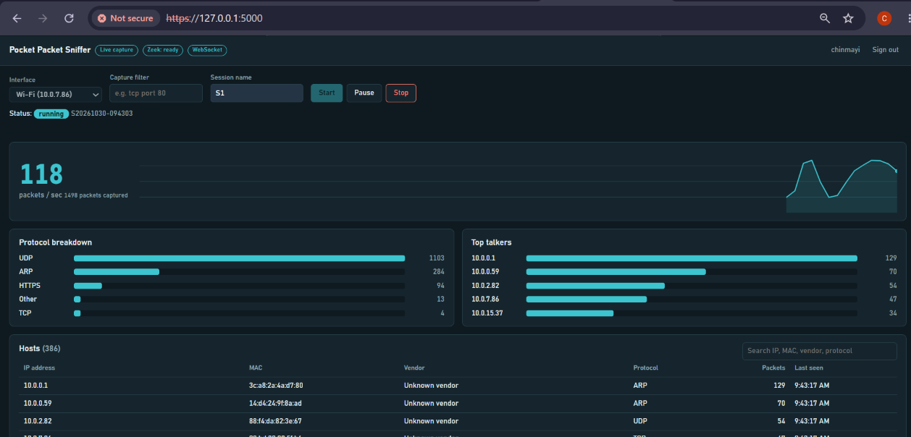
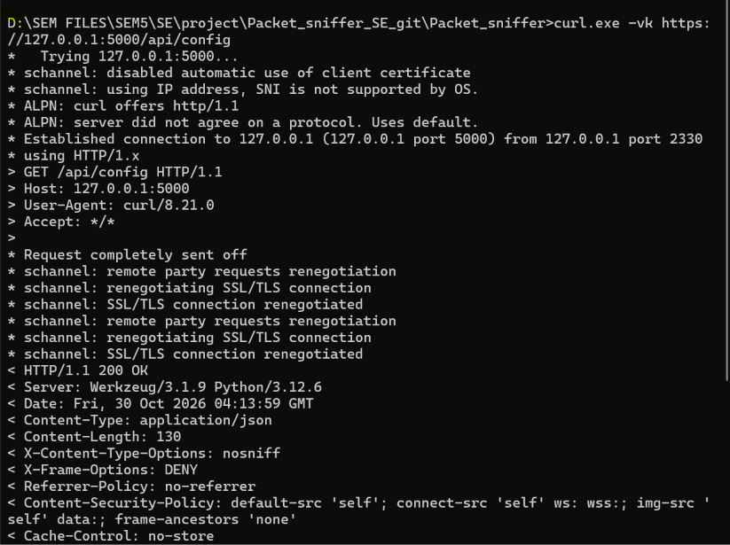
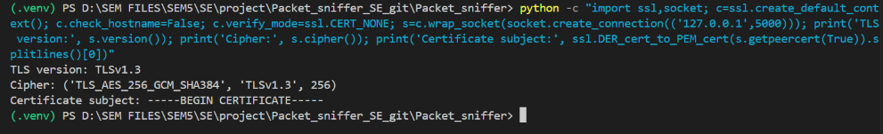
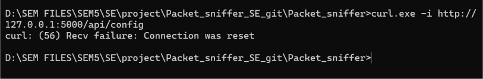

# TC-SEC-02: HTTPS/TLS protection of dashboard communication

| Field | Value |
|---|---|
| Requirement | PPS-SR-002 (communication between the web dashboard and the backend shall use HTTPS/TLS where supported) |
| Related requirements | PPS-SR-001, PPS-F-021 |
| Story / Issue | #50 |
| Test case | TC-SEC-02 |
| Tester | Chinmayi Hebbar A M |
| Date | 30-10-2026 |
| Branch | `feature/PPS-SR-002-https` |
| Environment | Windows, Python 3.12.6, Flask (Werkzeug 3.1.9) dashboard, Chrome, curl 8.21.0 |

## 1. Acceptance criterion

From the SRS: *network traffic between the client and the application shall not expose credentials or sensitive data in plaintext.*

## 2. Setup

A self-signed certificate (RSA 2048, valid 365 days, `CN=localhost`) was generated with OpenSSL:

```
openssl req -x509 -newkey rsa:2048 -nodes -keyout dashboard\data\key.pem -out dashboard\data\cert.pem -days 365 -subj "/CN=localhost"
```

The dashboard reads the certificate and key from two environment variables and serves HTTPS when both are set (`dashboard/app.py`, function `main`):

```
$env:PPS_TLS_CERT = "<full path>\dashboard\data\cert.pem"
$env:PPS_TLS_KEY  = "<full path>\dashboard\data\key.pem"
python app.py
```

The certificate and private key are stored in `dashboard/data/`, which is excluded from Git, so no key material is committed.

## 3. Test steps and results

### 3.1 Browser connects over HTTPS

Opening `https://127.0.0.1:5000` shows Chrome's certificate warning `NET::ERR_CERT_AUTHORITY_INVALID`. This is the expected result for a self-signed certificate: the connection is TLS, but the certificate is not issued by a trusted authority. After choosing "Proceed", the sign-in page and the dashboard load over `https://`.





### 3.2 TLS request succeeds

```
curl.exe -vk https://127.0.0.1:5000/api/config
```

The TLS handshake completes (Windows schannel) and the server returns `HTTP/1.1 200 OK` with the security headers (`X-Content-Type-Options`, `X-Frame-Options`, `Content-Security-Policy`, `Cache-Control: no-store`). The `-k` flag is used only because the test certificate is self-signed.



### 3.3 Negotiated protocol and cipher

A Python TLS client connected to port 5000 and reported:

```
TLS version: TLSv1.3
Cipher: ('TLS_AES_256_GCM_SHA384', 'TLSv1.3', 256)
```



### 3.4 Plain HTTP is not accepted on the HTTPS port

```
curl.exe -i http://127.0.0.1:5000/api/config
curl: (56) Recv failure: Connection was reset
```

The server resets a plaintext request instead of answering it, so credentials sent as plain HTTP to this port are never processed.



## 4. Result

| Check | Result |
|---|---|
| Dashboard served over HTTPS when a certificate is configured | **Pass** |
| TLS 1.3 with AES-256-GCM negotiated | **Pass** |
| Plain HTTP request to the HTTPS port refused | **Pass** |
| Credentials and data travel only inside the TLS channel | **Pass** (by protocol; no packet capture performed) |

**Overall result: PASS** (for deployments where a certificate is configured, per "where supported" in PPS-SR-002).

## 5. Limitations and notes

- HTTPS is **off by default**. With no certificate variables the dashboard serves plain HTTP on `127.0.0.1`, which is local-only. Anyone who exposes the dashboard on a LAN should enable HTTPS.
- The test certificate is self-signed, so browsers warn. A deployment would use a certificate from a trusted authority, or the team's own CA installed on client machines.
- No HTTP-to-HTTPS redirect and no HSTS header are implemented. A plain HTTP request to the HTTPS port is simply refused.
- This evidence shows the TLS version, cipher and refusal of plaintext. A Wireshark capture of a login (readable over HTTP, unreadable over HTTPS) was not performed. It can be added as extra evidence.

RTM update: PPS-SR-002 status changes from N to P.
