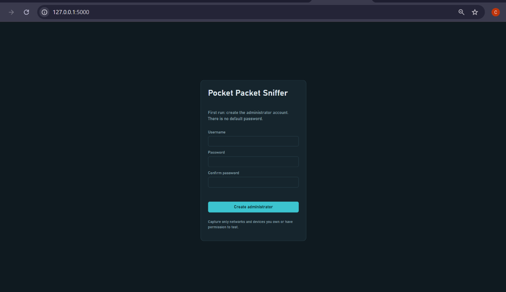
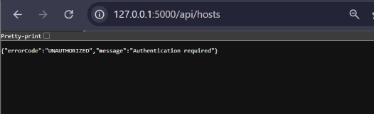
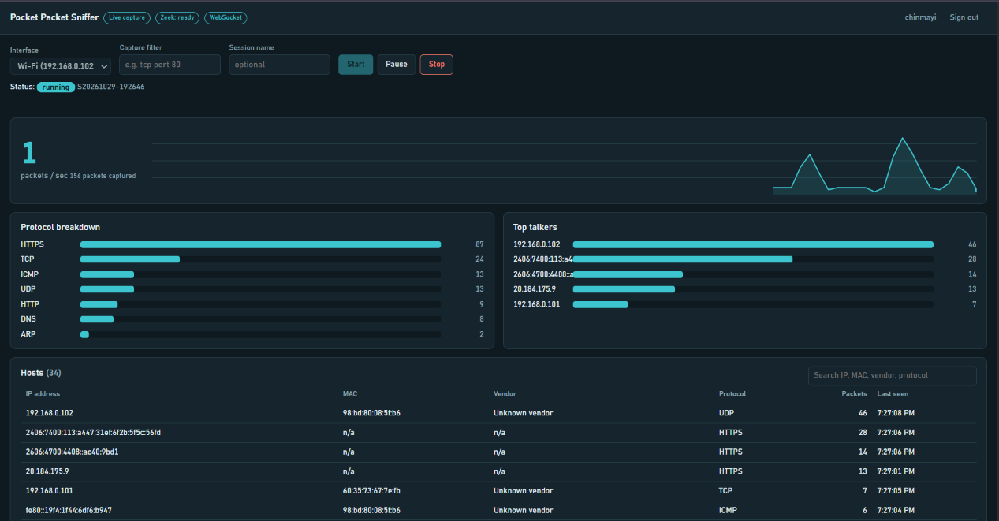

# TC-SEC-04: Hardcoded-secret scan and first-run credential verification

| Field | Value |
|---|---|
| Requirement | PPS-SR-004 (no hardcoded credentials or secrets; administrator creates credentials at first run) |
| Related requirements | PPS-SR-001, PPS-F-021 |
| Story / Issue | #51 |
| Test case | TC-SEC-04 |
| Tester | Chinmayi Hebbar A M |
| Date | 29-10-2026 |
| Branch | `feature/PPS-SR-004-secret-scan` |
| Environment | Windows, Python 3.12.6, `.venv`, Flask dashboard in demo or live mode |

## 1. Acceptance criterion

From the SRS: *static code analysis shall detect no hardcoded secrets, and the initial setup shall require the creation of administrator credentials.*

## 2. Secret scan (detect-secrets 1.5.0)

Command:

```
python -m detect_secrets scan --all-files --exclude-files "\.venv|\.git|\.pytest_cache" | Out-File -Encoding utf8 docs\evidence\secret-scan.json
```

Report: `secret-scan.json`

| Run | Result |
|---|---|
| First run (before review) | 5 detections |
| After review and allowlisting | **0 findings** |

Detections reviewed in the first run:

| Location | Detector type | Content | Verdict |
|---|---|---|---|
| `.pytest_cache/CACHEDIR.TAG` | Hex high-entropy string | Standard pytest cache marker. Not source code and not tracked by Git. | False positive (folder excluded from the final scan) |
| `dashboard/tests/conftest.py` line 8 | Secret keyword | Throwaway `PPS_JWT_SECRET` used only by the automated tests | Test-only value |
| `dashboard/tests/conftest.py` line 18 | Secret keyword | Test username and password (`analyst`) used only by the automated tests | Test-only value |
| `dashboard/tests/test_auth_export_sessions.py` line 29 | Secret keyword | Deliberately wrong password used to test lockout | Test-only value |
| `backend/tests/test_auth.py` line 33 | Secret keyword | Test password used by the auth tests | Test-only value |

Each test-only value is marked with `# pragma: allowlist nextline secret`, so the scanner keeps scanning the test folders and the exception is visible in the code. No credential, key or token exists in the application source (`backend/`, `dashboard/`, `capture/`).

## 3. Static analysis (bandit 1.9.4)

Command:

```
python -m bandit -r backend dashboard capture -x dashboard\tests,backend\tests,.venv -f txt -o docs\evidence\bandit-report.txt
```

Report: `bandit-report.txt`

Result: **0 High, 0 Medium**, and only Low-severity findings. There are **no hardcoded-password findings** (B105, B106, B107).

| Finding | Location | Assessment |
|---|---|---|
| B404, B603 `subprocess` | `backend/zeek_runner.py` | Zeek is started with a fixed argument list and no shell, so user input cannot be injected. |
| B101 `assert` (16 hits) | `capture/tests/test_capture.py` | Test code. Assertions are how pytest checks results. |
| B311 `random` | `dashboard/app.py` | Used only for +/-3 percent jitter in demo data. Not used for security. |
| B110 `try/except/pass` (3 hits) | `dashboard/app.py`, `dashboard/live_capture.py` | Intentional. A bad packet or a closed WebSocket must not stop the capture thread. |

## 4. First-run behaviour

The dashboard was started with an empty data folder (`PPS_DATA_DIR` pointing at a temporary directory) to simulate a fresh install. `GET /api/auth/state` returned `{"setupRequired": true}`.

1. **First-run setup screen.** With no user in the database, the page shows "Create administrator" with username, password and confirm-password fields. There is no default account and no way to sign in.

   

2. **Protected endpoint without a token.** Requesting `/api/hosts` without logging in returns HTTP 401 with `{"errorCode":"UNAUTHORIZED","message":"Authentication required"}`.

   

3. **After setup.** Once the administrator account is created, sign-in works and the dashboard loads.

   

## 5. How secrets are handled

- The JWT signing secret is read from the `PPS_JWT_SECRET` environment variable. If it is not set, the dashboard generates a random value at startup (`secrets.token_hex(32)`). Tokens then end when the server restarts.
- Passwords are stored only as salted bcrypt hashes. The database has no column for a plain password.
- The audit log records event names, usernames and session IDs, never passwords or tokens.
- `dashboard/data/` (auth database, audit log, session PCAPs) is excluded from Git through `.gitignore`.
- The only secret value in CI is a fallback throwaway string used for tests (`ci-only-throwaway-secret`). Real deployments use repository secrets.

## 6. Result

| Check | Result |
|---|---|
| No hardcoded secrets found by static analysis | **Pass** |
| No default or hardcoded credentials in the application | **Pass** |
| First run requires creation of administrator credentials | **Pass** |
| Protected endpoints refuse unauthenticated requests (401) | **Pass** |

**Overall result: PASS**

RTM update: PPS-SR-004 status changes from N to P.
